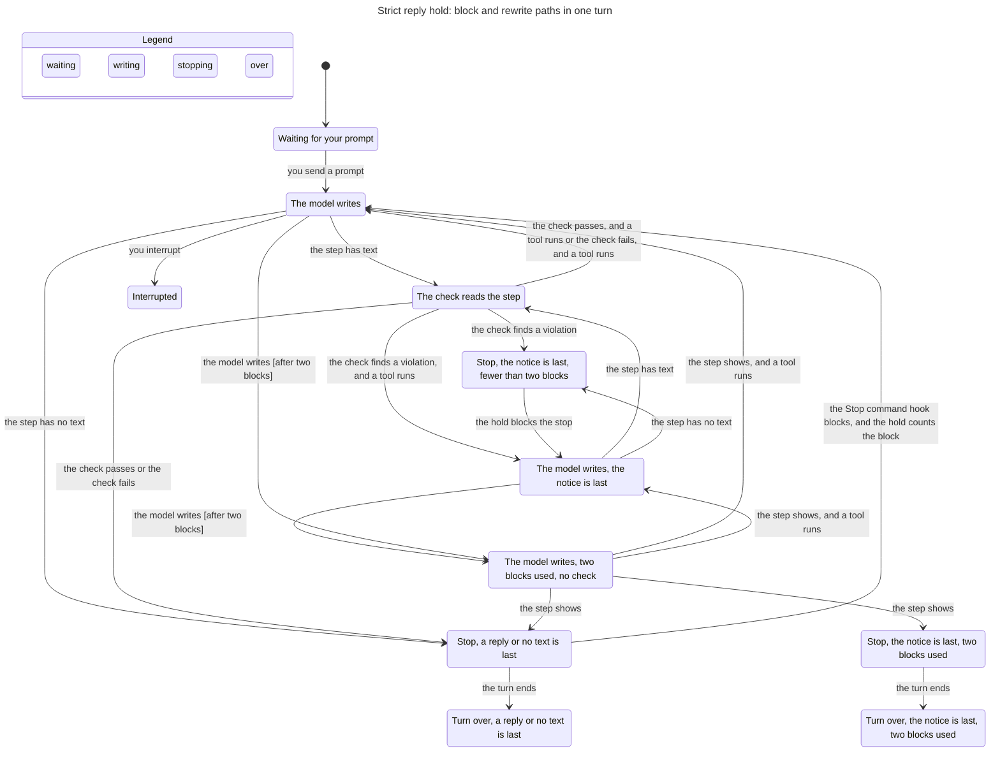

## State chart

This chart shows the stop and rewrite paths of the strict reply hold that this PR corrects.
TLC drew it from a scratch copy of `ReplyHold.tla` with one turn and one tool step (267 states).
No rule breaks in this chart.

What the PR changes in the chart:

- A step with no text after the notice leads to "Stop, the notice is last, fewer than two blocks".
  The hold blocks there. Before the PR, the turn ended there, and the notice stayed.
- "the hold blocks the stop" leads back to "The model writes, the notice is last".
  The notice stays the last text until a step shows text, so a rewrite with no text leads to a second block.
- "the Stop command hook blocks, and the hold counts the block" uses one of the two blocks.
  Before the PR, the hold still allowed two more blocks, so a turn had three.
- "Turn over, the notice is last, two blocks used" stays reachable.
  After two blocks, the hold shows the next step as written, also when it has no text.

The chart shows "you interrupt" only from "The model writes".
It does not draw steps that stay in one chart state.

Covered digest: `634ae73ccbc7bd281bb8b509d3ae6fc5b6962548ba23e7621fa635d6c7bc3539`
