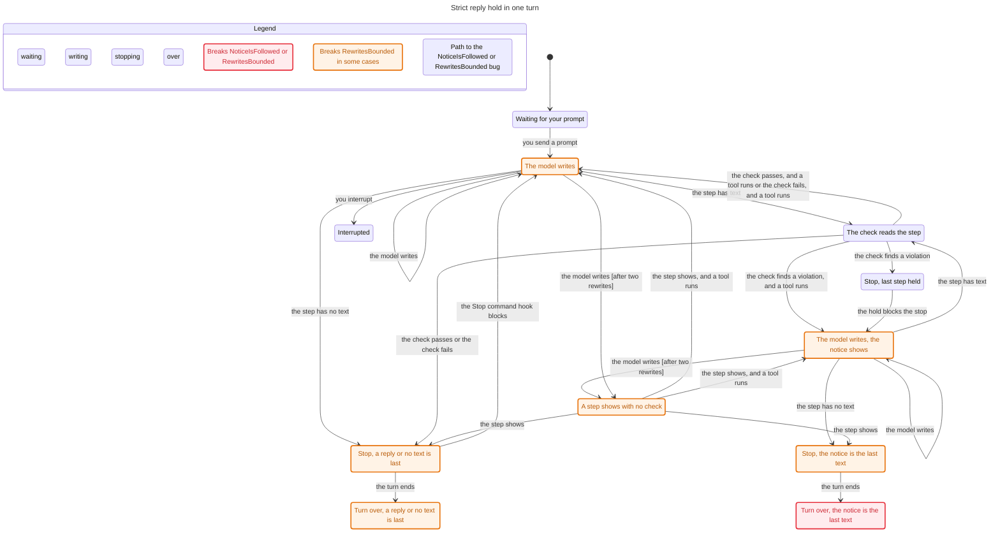

## State chart

This chart shows the behavior that this PR adds a check for: one strict-mode turn of the reply hold, from `hooks/reply-hold.ts` and the `Stop` command hook.
TLC drew it from a scratch copy of `ReplyHold.tla` with one turn and one tool step (426 states).

Bugs that the chart marks:

- `NoticeIsFollowed` breaks: "When a turn ends, the last text on the screen is not the hold notice." Path: you send a prompt, the check finds a violation and a tool runs, the model ends the turn with no text, the turn ends.
- `RewritesBounded` breaks: "A turn has two Stop blocks or fewer, as ADR 0005 states." Path: the check fails, the Stop command hook blocks, the hold blocks two times.

The chart shows "you interrupt" only from "The model writes". It does not draw steps that stay in one chart state.

Covered digest: `ca49447b0b4b36e310ff015dc617a189b35a79cbc83e927d6011bc5900c61079`
